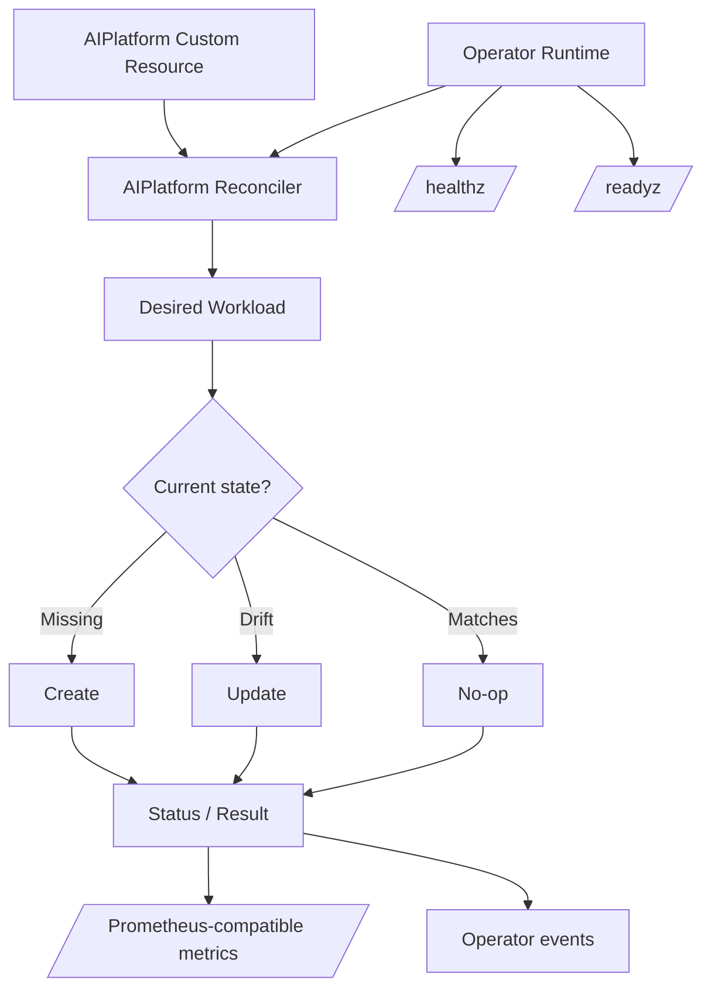

# Platform Engineering Kubernetes Operator

[](https://github.com/abdallauno1/platform-engineering-kubernetes-operator/actions/workflows/ci.yml)

A four-day portfolio project exploring the core engineering properties of a Kubernetes operator in Go: custom resources, reconciliation, convergence, drift detection, status, lifecycle primitives, health/readiness, metrics, containerization and CI.

## Project status

**v1.0.0 / Day 4 complete**

| Day | Focus | Result |
| --- | --- | --- |
| 1 | Foundation | CRD model, validation, basic reconciliation |
| 2 | Architecture evolution | Idempotent create/update/no-op, drift detection, status |
| 3 | Production readiness | Long-running runtime, probes, graceful shutdown, Docker/Kubernetes/Kustomize |
| 4 | Advanced features & polish | Metrics, finalizers, events, security CI, release documentation |

## Architecture



The reconciliation policy depends on the small `WorkloadClient` interface. The included memory implementation keeps unit tests deterministic. A cluster-backed implementation can replace it without changing the reconciliation policy.

## Reconciliation contract

For each `AIPlatform` resource the controller derives a desired workload and converges toward it:

- workload absent -> `Created`
- workload differs -> `Updated`
- workload already matches -> `Unchanged`
- validation/client failure -> `Failed`

Repeated reconciliation against matching state is a no-op, which makes the policy idempotent.

## Lifecycle and observability

Day 4 adds:

- `AIPlatformFinalizer` helpers with idempotent add/remove behavior
- event recorder abstraction
- Prometheus text-format reconciliation counters
- reconciliation error counter
- `/healthz` and `/readyz`
- graceful SIGINT/SIGTERM shutdown

## Repository layout

```text
.
├── .github/              # CI and Dependabot
├── api/v1/               # AIPlatform API model
├── cmd/operator/         # Runtime and demo entrypoint
├── config/               # CRD, RBAC, Deployment, Kustomize, NetworkPolicy, sample
├── docs/                 # Architecture, sequence, deployment and day notes
├── internal/controller/  # Reconciliation, clients, finalizers, metrics
├── internal/events/      # Event recorder abstraction
├── internal/health/      # Liveness/readiness HTTP server
├── scripts/              # Verification helper
├── Dockerfile
├── Makefile
├── CHANGELOG.md
├── CONTRIBUTING.md
└── SECURITY.md
```

## Quick start

Requirements: Go 1.23+, Docker for container commands, and `kubectl` for manifest rendering/deployment.

```bash
go test ./...
go run ./cmd/operator --mode demo
```

Run the long-lived process:

```bash
go run ./cmd/operator --mode operator --health-addr :8081 --reconcile-interval 5s
```

Then:

```bash
curl http://localhost:8081/healthz
curl http://localhost:8081/readyz
```

## Verification

```bash
make ci
```

This checks formatting, vet, race-enabled tests and build.

Container build:

```bash
make docker-build
```

Render Kubernetes manifests:

```bash
kubectl kustomize config
```

## CI/CD

GitHub Actions validates every push/PR to `main` with:

1. formatting
2. `go vet`
3. race-enabled unit tests + coverage artifact
4. Go build
5. `govulncheck`
6. Docker Buildx container build

Dependabot monitors Go modules and GitHub Actions weekly.

## Kubernetes deployment

The repository includes a namespace, CRD, ServiceAccount/RBAC, hardened Deployment, NetworkPolicy, sample custom resource and Kustomize entrypoint under `config/`.

```bash
kubectl apply -k config
```

## Design scope

This project intentionally separates **reconciliation policy** from **cluster transport**. The shipped `WorkloadClient` is an in-memory adapter used by the runnable portfolio demo and tests; it does not claim to persist managed workloads through the Kubernetes API. The natural production extension is a `client-go` or `controller-runtime` adapter plus watch-based reconciliation.

That boundary is deliberate: the repository demonstrates convergence, idempotency and operator lifecycle patterns without hiding infrastructure behavior behind an inaccurate claim.

## Documentation

- [Architecture](docs/architecture.md)
- [Sequence](docs/sequence.md)
- [Deployment](docs/deployment.md)
- [Day 4 notes](docs/day4.md)
- [Changelog](CHANGELOG.md)
- [Contributing](CONTRIBUTING.md)
- [Security](SECURITY.md)

## License

MIT. See [LICENSE](LICENSE).
