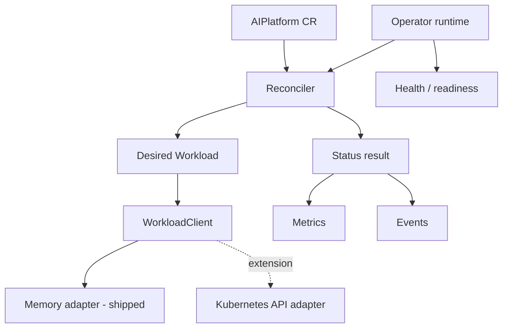

# Architecture

The controller owns policy: validation, desired-state derivation, drift detection and result/status calculation. Infrastructure access is behind `WorkloadClient`, making policy independently testable.
